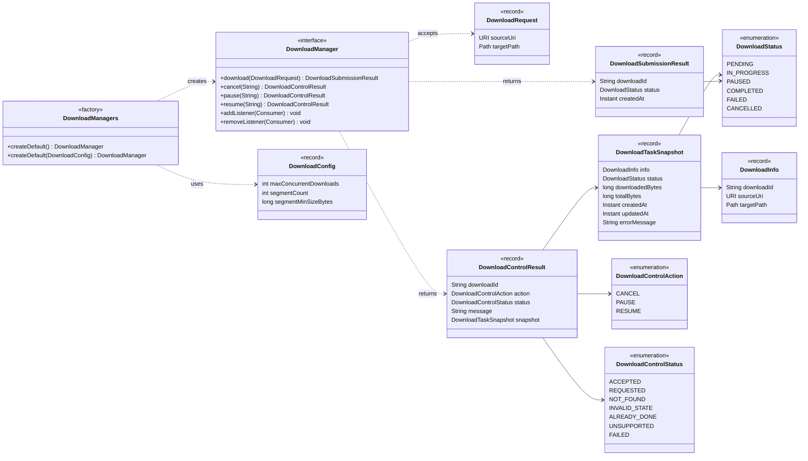
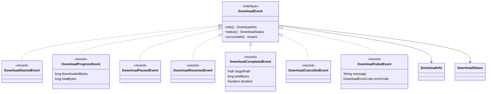
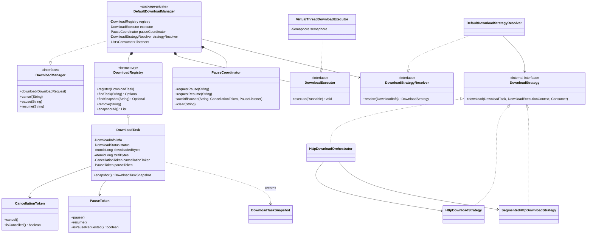

# Class Model

Static structure of the public API and of the internal collaborators that execute a download.

**Last verified:** 2026-11-03
**Evidence:** `katabasis-core/src/main/java/jsanca/katabasis/core/api/**` and `internal/**`; `katabasis-ui` for the consumer side.

## Public API — management surface

Every type below is exported by `jsanca.katabasis.core.api.*`. Records are immutable; enums are closed sets.

## Public API — event hierarchy

All events are records implementing the `DownloadEvent` interface.

## Internal collaborators

The implementation lives in `internal.*` and is never exported.

## Notes that the diagrams cannot show

- `DefaultDownloadManager` is not a top-level type: it is a package-private static nested class of `DownloadManagers`, so callers only ever see the `DownloadManager` interface.
- `DownloadRegistry` and all task state are in memory. Tasks are removed in a `finally` block when they reach a terminal state, so their final state is not queryable afterwards.
- `S3DownloadStrategy`, `S3UriParser`, and the three `RetryPolicy` placeholder classes exist in `internal.*` but contain no logic; they are intentionally absent from the collaborator diagram.
- `DownloadProgress` in `api.model` is an empty placeholder class and is not part of the live flow; progress is carried by `DownloadProgressEvent`.

## Related

- [Module map](module-map.md)
- [Architecture: current state](katabasis-core.md)
- [Download lifecycle and control flows](../flows/download-lifecycle.md)
- [Editorial version of the collaborator diagram](diagrams/core-collaborators.html)
