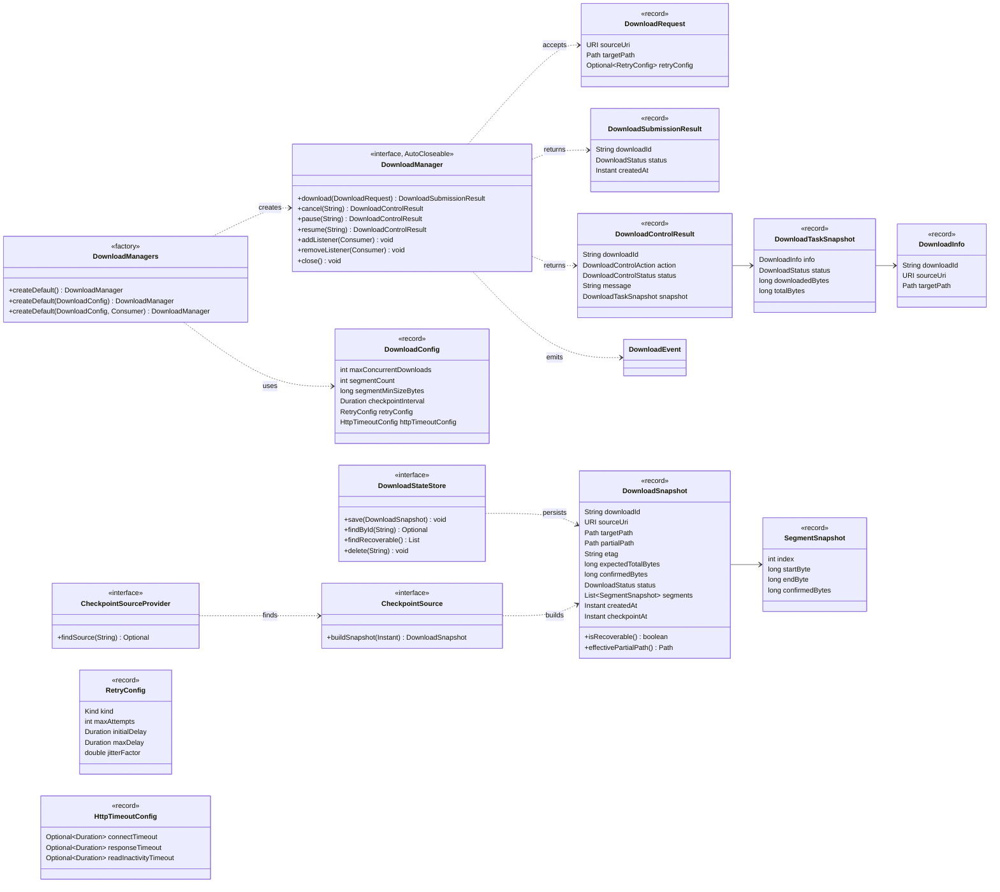
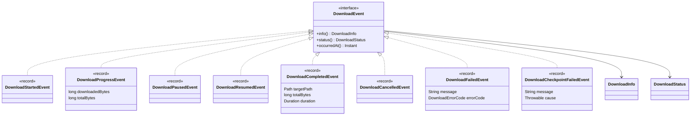
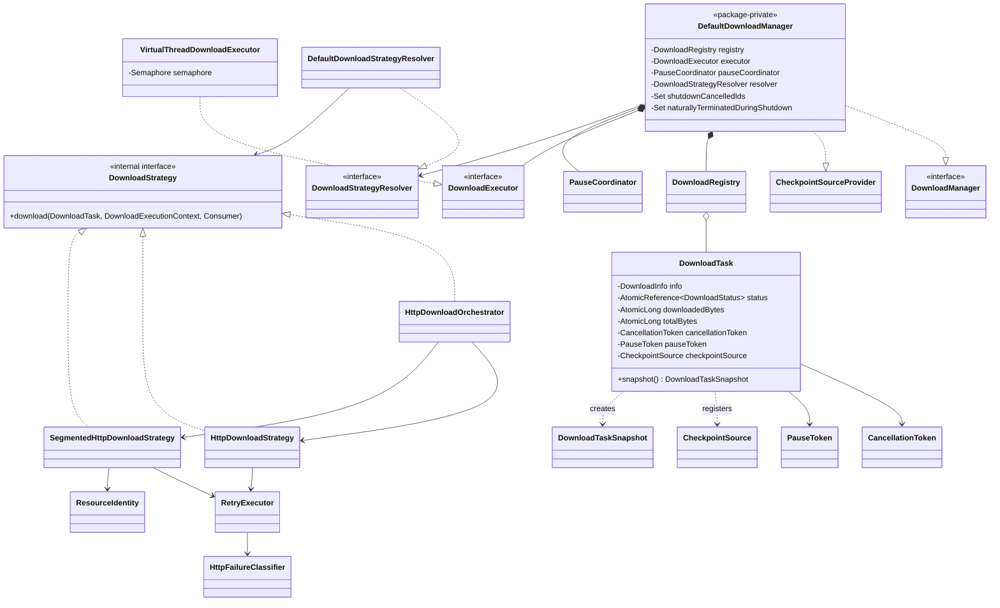

# Class Model

Static structure of the public API, the event contract, and the internal collaborators that execute a download.

**Last verified:** 2026-11-18  
**Baseline:** `f999777`  
**Evidence:** `katabasis-core` and `katabasis-storage-json` source at the baseline.

## Public API — management and checkpoint ports

## Public API — event hierarchy

## Internal collaborators

## Notes the diagrams cannot show

- `DefaultDownloadManager` is a package-private nested class of `DownloadManagers`; callers see only `DownloadManager`, and the checkpoint coordinator sees it through `CheckpointSourceProvider`.
- `download()` returns immediately with `PENDING`; the worker runs on a virtual thread bounded by a semaphore.
- Core owns the checkpoint ports and domain records; `katabasis-storage-json` owns the JSON adapter and `CheckpointCoordinator` (see [checkpointing.md](checkpointing.md)).
- Retry is functional (`RetryExecutor`, `HttpFailureClassifier`); the old empty `RetryPolicy` family is now an internal strategy contract, not a stub.
- Removed by K-CLEANUP-001 and absent from this model: `DownloadScheduler`, `ExecutionSlotController`, `ProgressReporter`, `QueuedDownloadTask`, all `internal.s3.*` placeholders, `DownloadIdGenerator`, and `PercentageCalculator`.
- Retained by K-CLEANUP-001 as public API vocabulary but behaviorless: `DownloadCapabilities`, `DownloadCommand`, `DownloadProgress`, `DownloadEventPublisher`, `DefaultDownloadEventPublisher`. They are not active components.

## Related

- [Architecture: current state](katabasis-core.md)
- [Checkpointing](checkpointing.md)
- [Module map](module-map.md)
- [Download lifecycle](../flows/download-lifecycle.md)
