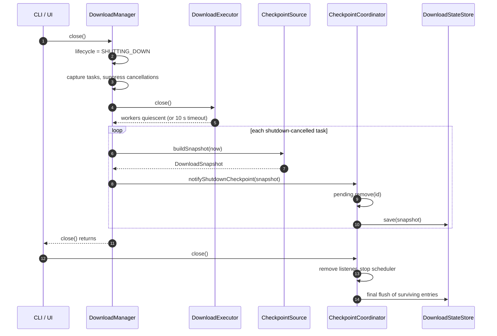

# Katabasis — Architecture (Current State)

**Last verified:** 2026-11-18  
**Baseline:** `f999777` — K-0.2-T10-HARDEN-001: Coordinated graceful shutdown & final checkpoint  
**Language/runtime:** Java 27 (`maven.compiler.release=27`)  
**Evidence:** production source at the baseline commit; ADR-002, ADR-003, ADR-004; K-0.2-T10 and K-0.2-T10-HARDEN-001 reports.

**Visual models:** [Module map](module-map.md) · [Class model](class-model.md) · [Checkpointing](checkpointing.md) · [Download lifecycle](../flows/download-lifecycle.md) · [CLI lifecycle](../flows/cli-lifecycle.md)

---

## Module Layout

Four Maven modules, each a named JPMS module. Java 27 is required. Core uses preview APIs (`StructuredTaskScope`), so core-dependent modules enable preview at test runtime.

| Maven module | JPMS module | Responsibility |
| --- | --- | --- |
| `katabasis-core` | `jsanca.katabasis.core` | Download engine: lifecycle, strategies, retry, concurrency, public API |
| `katabasis-storage-json` | `jsanca.katabasis.storage.json` | JSON checkpoint adapter and checkpoint coordinator |
| `katabasis-cli` | `jsanca.katabasis.cli` | picocli command line (`download`, `download-list`) |
| `katabasis-ui` | `jsanca.katabasis.ui` | JavaFX desktop application |

Compile-time dependencies:

```
katabasis-cli     ──requires──> katabasis-core
                  ──requires──> katabasis-storage-json
                  ──requires──> info.picocli

katabasis-ui      ──requires──> katabasis-core
                  ──requires──> katabasis-storage-json
                  ──requires──> JavaFX / AtlantaFX / Ikonli

katabasis-storage-json ──requires──> katabasis-core
```

`katabasis-core` has no compile-time dependency on storage, CLI, or UI. Persistence is an external adapter over core ports.

### JPMS API boundary

`katabasis-core` exports only:

- `api.event` — event types
- `api.exception` — public exceptions
- `api.manager` — `DownloadManager`, `DownloadManagers`, `DownloadStateStore`, `CheckpointSource`, `CheckpointSourceProvider`
- `api.model` — request, config, status, snapshot and result records

`internal.*` is module-private. `katabasis-storage-json` exports only `jsanca.katabasis.storage.json.api`.

---

## Download Execution

### DownloadManager

Public orchestration interface, now `AutoCloseable`. Factory: `DownloadManagers.createDefault()` and `createDefault(config, shutdownSnapshotConsumer)`.

Operations: `download(DownloadRequest)`, `cancel(id)`, `pause(id)`, `resume(id)`, `addListener(...)`, `removeListener(...)`, `close()`.

`download()` registers a task, submits it to the executor, and returns a `DownloadSubmissionResult` with `PENDING` status immediately. Once shutdown begins, submissions throw `DownloadRejectedException`.

`DefaultDownloadManager` is a hidden factory inner class. It implements both `DownloadManager` and `CheckpointSourceProvider`, so the checkpoint coordinator can look up per-download sources through an explicit cast without widening the public manager interface.

### DownloadExecutor

`DownloadExecutors.createVirtualThreadExecutor(config)` backs execution with virtual threads and a `Semaphore` capped at `maxConcurrentDownloads`. `close()` stops admission and waits up to 10 seconds for running workers to reach quiescence.

### Strategy resolution and HTTP execution

`DefaultDownloadStrategyResolver` routes by URI scheme through `Scheme.from()`:

- `http`, `https` → `HttpDownloadOrchestrator`
- anything else → `IllegalArgumentException`

| Component | Role |
| --- | --- |
| `HttpDownloadOrchestrator` | Probes `Accept-Ranges` and content length; chooses segmented or single-stream |
| `HttpDownloadStrategy` | Single-stream HTTP/HTTPS using the JDK `HttpClient` |
| `SegmentedHttpDownloadStrategy` | Parallel byte-range chunks written at absolute file positions through `StructuredTaskScope` |
| `HttpRangeSupport` / `ResourceIdentity` | Range negotiation, strong ETag and content-length identity checks |
| `InactivityWatchdog` | Read-inactivity timeout enforcement; paused time is excluded |

Segmentation requires `Accept-Ranges: bytes` **and** content length ≥ `segmentMinSizeBytes` (default 5 MB). A failed probe falls back to single-stream.

### Retry

Retry is functional. `RetryConfig` selects `NONE`, `FIXED_DELAY`, or `EXPONENTIAL_BACKOFF` with max attempts, initial/max delay, and jitter. A per-request override takes precedence over `DownloadConfig.retryConfig()`. `HttpDownloadStrategy` and `SegmentedHttpDownloadStrategy` execute through `RetryExecutor`; `HttpFailureClassifier` decides whether a failure is retryable. The CLI maps `--retries N` to a 1-second fixed delay.

### Timeouts

`HttpTimeoutConfig` carries three optional durations:

- `connectTimeout` — TCP connection establishment
- `responseTimeout` — time to first response headers (not body transfer)
- `readInactivityTimeout` — no-body-bytes watchdog (pause time excluded)

Absent values leave the JDK defaults in place.

### Events

Events are records implementing `DownloadEvent` and are delivered synchronously on the download thread:

| Event | When emitted |
| --- | --- |
| `DownloadStartedEvent` | Worker begins executing the download |
| `DownloadProgressEvent` | Per read buffer / chunk write |
| `DownloadPausedEvent` | Strategy observes a pause request |
| `DownloadResumedEvent` | Strategy unblocks after resume |
| `DownloadCompletedEvent` | Successful completion, with duration |
| `DownloadCancelledEvent` | Explicit cooperative cancellation |
| `DownloadFailedEvent` | Any non-cancellation failure, with `DownloadErrorCode` |
| `DownloadCheckpointFailedEvent` | Checkpoint save/delete failure (emitted by the coordinator) |

Shutdown-initiated cancellation is deliberately **not** emitted as `DownloadCancelledEvent`; see [Graceful Shutdown](#graceful-shutdown).

---

## Checkpoint Architecture

Detailed ownership and guarantees: [checkpointing.md](checkpointing.md).

| Component | Module | Ownership |
| --- | --- | --- |
| `CheckpointSource` | core `api.manager` | Strategy contract that builds an internally consistent `DownloadSnapshot` |
| `CheckpointSourceProvider` | core `api.manager` | Lookup port for the active source; implemented by `DefaultDownloadManager` |
| `DownloadStateStore` | core `api.manager` | Persistence port (`save`, `findById`, `findRecoverable`, `delete`) |
| `DownloadSnapshot` / `SegmentSnapshot` | core `api.model` | Immutable persisted state |
| `CheckpointCoordinator` | storage-json `api` | Event listener, flush scheduling, shutdown checkpoint handling |
| `FileDownloadStateStore` | storage-json `internal.store` | Versioned JSON manifests, atomic write, per-ID locking |

Flow at a high level:

1. An HTTP strategy registers a `CheckpointSource` on its `DownloadTask` after response headers (or after segment negotiation).
2. `CheckpointCoordinator` observes manager events. Progress and start events update pending state; pause saves immediately.
3. At each flush (default 5 s), the coordinator asks `CheckpointSourceProvider` for the per-download source and persists `buildSnapshot(now)`. Without a source it falls back to the event-derived snapshot.
4. Completed and explicitly cancelled downloads delete their manifest. Failed downloads retain a `FAILED` manifest for inspection.
5. Shutdown checkpoints use `notifyShutdownCheckpoint()`, which removes the pending entry before saving.

Manifests are JSON envelopes with `envelopeVersion`, `type`, `id`, `schemaVersion`, `revision`, and a `payload` containing the `DownloadSnapshot`. See ADR-002 for the schema and migration policy.

### Persistence guarantees (summary)

- Atomic visibility is conditional on filesystem `ATOMIC_MOVE`; the adapter logs a warning and falls back to non-atomic replace otherwise.
- No `fsync` is performed. Checkpoints survive process termination (including `kill -9`) but are not guaranteed across kernel crash or power loss.
- `confirmedBytes` means bytes accepted by the write API, not cryptographically verified bytes.
- Segment snapshots describe confirmed contiguous prefixes.
- ETag is a resource validator, not a checksum.
- Corrupt manifests are skipped and never authorize recovery.
- Multiple processes writing the same checkpoint directory are not supported.
- **Persistent recovery is not implemented.** K-0.2-T11 is pending. The store can discover recoverable snapshots, but no component resumes them.

---

## Graceful Shutdown

Verified against `DownloadManagers.DefaultDownloadManager.close()` and `CheckpointCoordinator` at baseline `f999777`.

The application-level order is **manager first, coordinator second**:

1. `DownloadManager.close()` takes the lifecycle write lock. The first caller sets `SHUTTING_DOWN`, captures active tasks, adds their IDs to `shutdownCancelledIds`, clears pause state, and requests cooperative cancellation. Later callers block on `closeLatch`.
2. The lock is released and `DownloadExecutor.close()` drains workers, waiting up to 10 seconds.
3. In a `finally` block, for each captured task that did not terminate naturally and has a non-null `CheckpointSource`, the manager builds a post-quiescence snapshot and calls the shutdown snapshot consumer.
4. CLI and UI wire that consumer to `CheckpointCoordinator.notifyShutdownCheckpoint(snapshot)`, which removes the pending entry and then saves the authoritative snapshot.
5. The manager marks itself `CLOSED` and releases `closeLatch`.
6. The caller then closes `CheckpointCoordinator`: it removes its listener, cancels the periodic flush, shuts down the scheduler (30 s await), and performs a final flush on the calling thread.

Cancellation-event distinction:

- **Explicit cancel:** `DownloadCancelledEvent` reaches the coordinator, the manifest is deleted, and the download is not recoverable.
- **Shutdown cancel:** the event is suppressed for `shutdownCancelledIds`; the manifest remains `IN_PROGRESS` with the last confirmed progress, so it is a recovery candidate once T11 exists.

Timeout behavior: if the executor's 10-second wait times out, it logs a warning and returns. Workers may still be writing while the post-quiescence snapshot loop runs. No event currently surfaces this condition. A shutdown that times out must **not** be described as quiescent.



---

## CLI Architecture

picocli 4.7.6, root command `katabasis`. Details: [CLI lifecycle](../flows/cli-lifecycle.md).

- `download <uri> --output <path>` — single download, progress rendering, interactive `p`/`r`/`c`/`q` when `System.console()` is available.
- `download-list <file> --output-dir <dir> [--max-concurrent N]` — one absolute URI per line; blank and `#` lines ignored; all entries pre-validated; duplicate output filenames rejected.
- Shared options: `--segments`, `--retries`, `--connect-timeout`, `--response-timeout`, `--read-timeout`.
- Exit codes: `0` success, `1` execution failure (including all-failed or shutdown-interrupted), `2` usage error, `3` partial batch failure (list only).
- Structured stderr: `ERROR code=... [downloadId=...] [source=...] message="..."`, with URI credentials stripped, and `SUMMARY total=... completed=... failed=... cancelled=... rejected=...`.
- `q` and SIGINT both trigger graceful shutdown; `c` is an explicit cancellation requiring `y` confirmation.
- Checkpoints: `~/.katabasis/checkpoints`, 5-second interval.

## katabasis-ui Architecture

Single-screen JavaFX application, no FXML. Wired to the same checkpoint infrastructure:

- `KatabasisLauncher` — JPMS entry point
- `DownloadManagerApplication` — owns the scene, `ObservableList<DownloadRow>`, the manager, and the `CheckpointCoordinator`
- `start()` creates `~/.katabasis/checkpoints`, builds the manager with a shutdown snapshot consumer, then creates the coordinator with a 5-second interval
- `stop()` closes the manager first, then the coordinator
- Events are marshalled to the FX thread with `Platform.runLater()`
- `DownloadRow` / `DownloadRowCell` render progress, status, and pause/resume/cancel actions

---

## Domain Model

Public data types are records with compact-constructor validation.

| Type | Purpose |
| --- | --- |
| `DownloadRequest` | URI, target path, optional per-request `RetryConfig` |
| `DownloadConfig` | Concurrency, segmentation, checkpoint interval, retry, HTTP timeouts; defaults 4 / 4 / 5 MB / 5 s / no retry / no timeouts |
| `DownloadInfo` | Immutable identity: id, source URI, target path |
| `DownloadSubmissionResult` | Submission result with `PENDING` status |
| `DownloadTaskSnapshot` | Point-in-time runtime view |
| `DownloadControlResult` | Control action, status, message, snapshot |
| `DownloadSnapshot` | Persisted recoverable state |
| `SegmentSnapshot` | Segment boundaries and confirmed prefix |
| `RetryConfig` | Retry kind, attempts, delays, jitter |
| `HttpTimeoutConfig` | Connect, response, read-inactivity timeouts |

`DownloadCapabilities`, `DownloadCommand`, `DownloadProgress`, `DownloadEventPublisher`, and `DefaultDownloadEventPublisher` were explicitly **retained** by K-CLEANUP-001 as public API vocabulary. They have no active behavior and must not be shown as working components.

---

## What Is Not Implemented

| Capability | Status |
| --- | --- |
| Persistent recovery (resume after restart) | **Pending — K-0.2-T11** |
| S3 protocol | No implementation; placeholders were removed in K-CLEANUP-001. Future capability (roadmap 0.3) |
| FTP/FTPS protocol | Not present |
| Checksum validation | Not implemented |
| `fsync` / power-loss durability | Not implemented |
| Multi-process checkpoint sharing | Not supported |
| Shutdown-timeout observability | Not implemented; warning logged only |
| CLI/API recovery command | Not implemented |

## Reconciliation Notes

- ADR-002 still contains T10-era "what is missing" handoff sections written before the wiring landed. The implemented state is the one described above; the ADR remains authoritative for persistence guarantees and schema, not for T10 wiring status.
- K-0.2-T10-HARDEN-001's report describes a `flushPending()` guard for a missing source with non-terminal status. At baseline `f999777` that guard is absent from `CheckpointCoordinator`; the implemented defense is the pending-entry removal in `notifyShutdownCheckpoint()` before saving. The report and code disagree; this page documents the code. The discrepancy is recorded in the curation report for follow-up.
