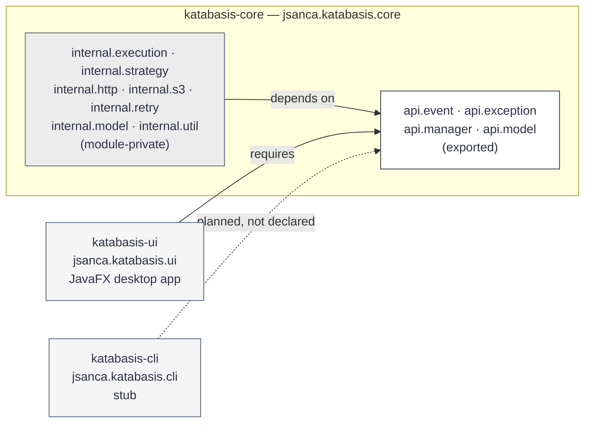

# Module Map

Current Maven modules, their JPMS names, and the dependency direction between them.

**Last verified:** 2026-11-03
**Evidence:** `katabasis-core/src/main/java/module-info.java`, `katabasis-ui/src/main/java/module-info.java`, `katabasis-cli/src/main/java/module-info.java`, root and per-module `pom.xml`.

## Reading the diagram

- **Dependency direction.** Arrows point from the consumer to the dependency: `katabasis-ui` requires the exposed API of `katabasis-core`, and `internal.*` packages depend on `api.*`.
- **The API boundary is enforced, not documented.** `katabasis-core` exports only `api.event`, `api.exception`, `api.manager`, and `api.model`. `internal.*` packages are module-private, so `katabasis-ui` and `katabasis-cli` cannot reference them.
- **CLI is not wired yet.** `katabasis-cli` does not declare `requires jsanca.katabasis.core`; its `module-info.java` exports nothing and `codex.Main` is a stub. The dashed arrow marks a planned dependency, not a current one.
- **UI is a real consumer.** `katabasis-ui` declares `requires jsanca.katabasis.core` and builds its screen exclusively against the exported API.

## Related

- [Architecture: current state](katabasis-core.md)
- [Class model](class-model.md)
- [Editorial version of this diagram](diagrams/module-map.html)
