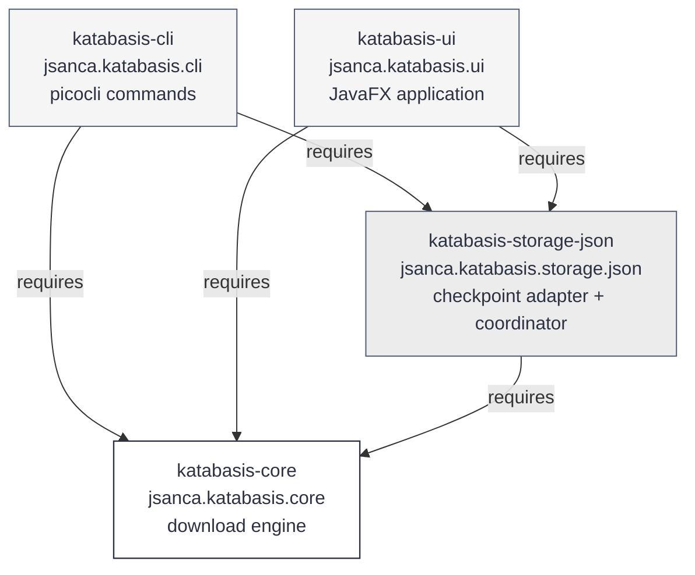

# Module Map

Current Maven modules, JPMS names, and compile-time dependency direction.

**Last verified:** 2026-11-18  
**Baseline:** `f999777`  
**Evidence:** root `pom.xml`, each module's `module-info.java` and `pom.xml`.

## Reading the diagram

- **Core is independent.** `katabasis-core` has no compile-time dependency on storage, CLI, or UI. Storage is an adapter over core ports (`DownloadStateStore`, `CheckpointSource`, `CheckpointSourceProvider`).
- **Both applications compose persistence.** `katabasis-cli` and `katabasis-ui` depend on `katabasis-storage-json` to create a `FileDownloadStateStore` and `CheckpointCoordinator`, and on `katabasis-core` for the engine.
- **Dependency direction is one-way.** `storage-json → core`, `cli → core + storage-json`, `ui → core + storage-json`. There are no cycles and no core-to-storage edge.
- **JPMS boundary.** Core exports only `api.event`, `api.exception`, `api.manager`, `api.model`. Storage exports only `jsanca.katabasis.storage.json.api`. `internal.*` remains module-private in both modules.
- **Java 27.** Core uses preview `StructuredTaskScope`; core-dependent modules enable preview at test runtime.

## Exported packages

| Module | Exports |
| --- | --- |
| `jsanca.katabasis.core` | `api.event`, `api.exception`, `api.manager`, `api.model` |
| `jsanca.katabasis.storage.json` | `api` |
| `jsanca.katabasis.cli` | none (entry point only; `opens` the package to picocli) |
| `jsanca.katabasis.ui` | `jsanca.katabasis.ui.app` |

## Related

- [Architecture: current state](katabasis-core.md)
- [Class model](class-model.md)
- [Checkpointing](checkpointing.md)
- [Editorial version of this diagram](diagrams/module-map.html)
