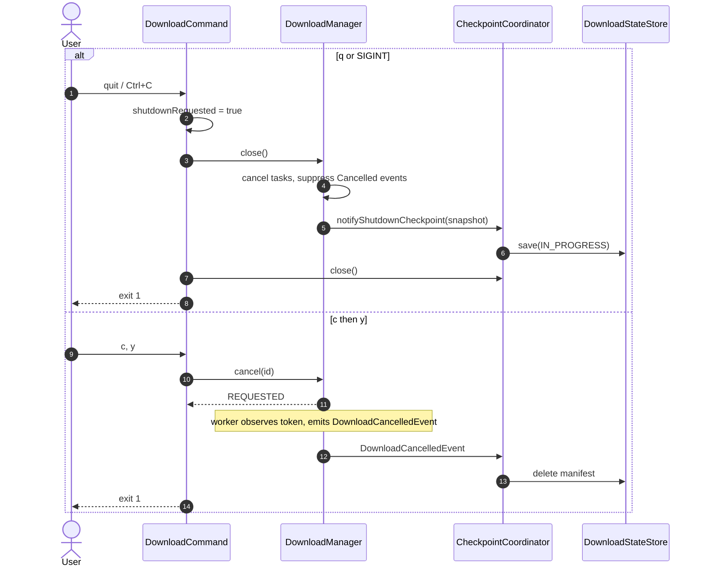

# CLI Lifecycle

Behavior of the implemented `katabasis` CLI: commands, interactive controls, shutdown versus cancellation, exit codes, and structured errors.

**Last verified:** 2026-11-18  
**Baseline:** `f999777`  
**Evidence:** `katabasis-cli` source; ADR-004 (picocli) and its K-0.2-ADR-HARDEN-001 amendment; K-0.2-T07/T08 reports.

## Commands

| Command | Usage | Notes |
| --- | --- | --- |
| `download` | `katabasis download <uri> --output <path>` | Single download with progress rendering |
| `download-list` | `katabasis download-list <file> --output-dir <dir> [--max-concurrent N]` | One absolute URI per line; blank lines and `#` comments ignored |
| root | `katabasis` | With no subcommand, prints help and returns 0 |

Shared options come from `DownloadConfigMixin`:

- `--segments <N>` — parallel segments (default 4, must be ≥ 1)
- `--retries <N>` — retry attempts with a 1-second fixed delay (default 0)
- `--connect-timeout <duration>` — connection timeout
- `--response-timeout <duration>` — response-header timeout
- `--read-timeout <duration>` — read-inactivity timeout

`download-list` additionally accepts `--max-concurrent <N>`.

## Interactive lifecycle (`download`)

Interactive controls are enabled only when `System.console() != null`; automated and non-interactive runs never block on input.

| Key | Action |
| --- | --- |
| `p` | `manager.pause(id)` — cooperative pause at the next checkpoint |
| `r` | `manager.resume(id)` — wake the paused worker |
| `c` | Requests cancellation **confirmation**; only `y` calls `manager.cancel(id)` |
| `q` | Graceful shutdown of the whole CLI session |

- Pause/resume are cooperative: the command returns before the transfer necessarily stops or resumes.
- `c` without `y` aborts the cancellation and keeps downloading.
- EOF on stdin ends the input worker without triggering shutdown.

## Shutdown versus cancellation

These are deliberately different:

| Aspect | Graceful quit (`q` / SIGINT) | Explicit cancel (`c` then `y`) |
| --- | --- | --- |
| Trigger | `requestShutdown` via input or JVM shutdown hook | `manager.cancel(id)` |
| Core behavior | `manager.close()`: stop admission, cancel active tasks, drain workers | Cooperative `CancellationToken` on one task |
| `DownloadCancelledEvent` | Suppressed for shutdown-cancelled IDs | Emitted and delivered |
| Checkpoint manifest | Retained as `IN_PROGRESS` with post-quiescence progress | Deleted |
| Recoverable later | Intended candidate once K-0.2-T11 exists | No |
| CLI exit code | 1 (execution failure / interrupted) | 1 |



The shutdown hook is registered per command and removed in `finally`. If the JVM is already shutting down, removal may fail and is ignored.

## Close order

Both CLI commands follow the same order in `finally`:

1. Remove the shutdown hook (best effort).
2. Remove the event listener.
3. `manager.close()` — authoritative post-quiescence snapshot is produced here.
4. `checkpointCoordinator.close()` — scheduler teardown and final flush.

Closing the coordinator first would miss the manager's final snapshot and is incorrect.

## Exit codes

| Code | Meaning | Applies to |
| --- | --- | --- |
| 0 | All requested downloads completed successfully | `download`, `download-list` |
| 1 | Execution failure: failed, cancelled, interrupted by shutdown, or all-failed batch | both |
| 2 | Usage error: invalid arguments, options, or configuration | both |
| 3 | Partial batch: at least one succeeded and at least one failed | `download-list` |

`download-list` pre-validates the whole file before starting. Duplicate output filenames are rejected. All downloads share one manager and run up to its concurrency limit.

## Structured errors

Errors go to stderr with a stable grammar:

```
ERROR code=<CODE> [downloadId=<ID>] [source=<URI>] message="<escaped>"
```

- `code` is one of `DOWNLOAD_FAILED`, `DOWNLOAD_CANCELLED`, `DOWNLOAD_REJECTED`, `INTERNAL_ERROR`.
- URI userinfo (`user:password@`) is stripped before output.
- Message escaping: `\` → `\\`, `"` → `\"`, CR/LF/TAB → `\r`/`\n`/`\t`.

Batch runs end with:

```
SUMMARY total=N completed=N failed=N cancelled=N rejected=N
```

## Checkpoints

Both commands resolve checkpoints to `~/.katabasis/checkpoints` (created on first use) and use a 5-second interval. Downloads that survive a graceful quit leave an `IN_PROGRESS` manifest; this is checkpoint state, not recovery: no CLI command resumes it yet (K-0.2-T11 pending).

## Related

- [Architecture: current state](../architecture/katabasis-core.md)
- [Checkpointing](../architecture/checkpointing.md)
- [Download lifecycle](download-lifecycle.md)
- ADR-004 — CLI framework
