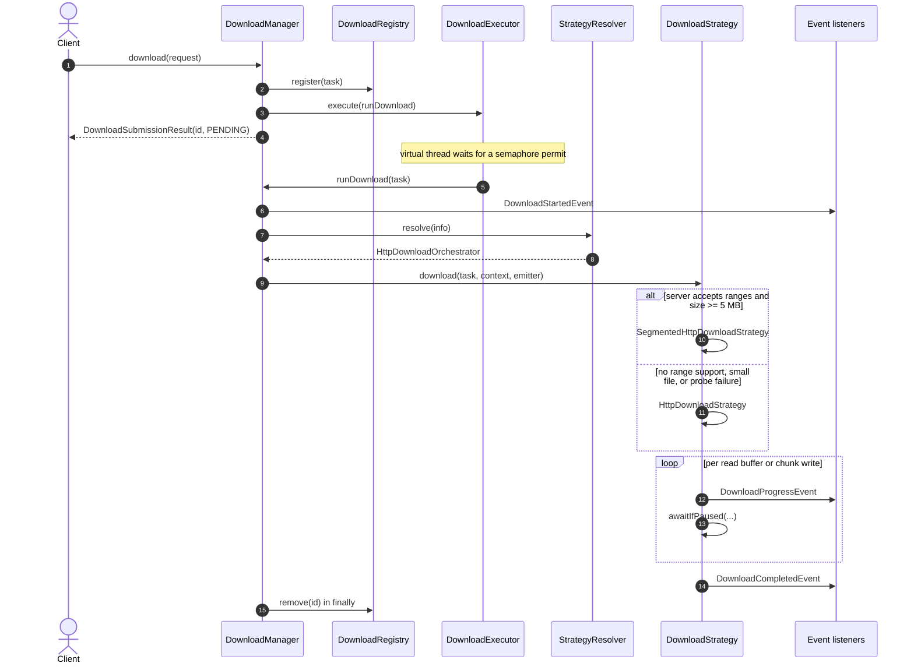
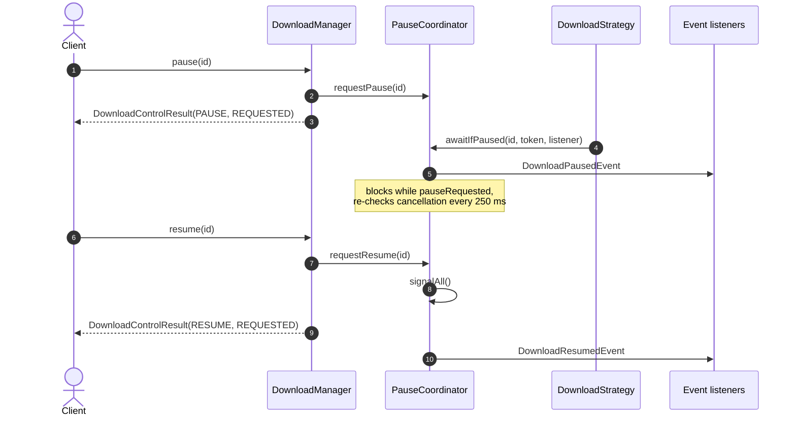
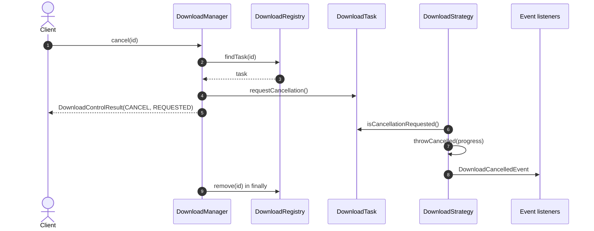

# Download Lifecycle

End-to-end behavior of a single download in `katabasis-core`: submission, strategy selection, progress, pause/resume, cancellation, and failure.

**Last verified:** 2026-11-03
**Evidence:** `DownloadManagers.DefaultDownloadManager`, `HttpDownloadOrchestrator`, `HttpDownloadStrategy`, `SegmentedHttpDownloadStrategy`, `PauseCoordinator`, `HttpDownloadSupport`.

## Happy path

### What the sequence fixes in place

- `download()` is non-blocking: it registers the task, hands it to the executor, and returns `DownloadSubmissionResult` with status `PENDING` immediately.
- The `DownloadStartedEvent` is emitted by the manager on the download thread, before the strategy is resolved.
- `DefaultDownloadStrategyResolver` maps only `http` and `https` to `HttpDownloadOrchestrator`; any other scheme raises `IllegalArgumentException`, which the manager turns into a `DownloadFailedEvent`.
- `HttpDownloadOrchestrator` probes the server with `HttpRangeSupport.probe()`. Segmented download requires `Accept-Ranges: bytes` **and** a content length of at least `segmentMinSizeBytes` (default 5 MB); a failed probe falls back silently to single-stream.
- Progress is emitted per read buffer (8 KB default) in the single-stream strategy, and per chunk write in the segmented strategy. Chunk threads share an atomic byte counter, so progress is aggregated.
- Events are delivered synchronously on the download thread; consumers that touch a UI must marshal to their own thread.
- The task is removed from the registry in a `finally` block, so terminal state is not queryable after completion.

## Pause and resume

- Pause is cooperative and checkpoint-based: the strategy calls `awaitIfPaused` after each unit of work, so the transfer stops at the next buffer or chunk boundary.
- The control call returns `REQUESTED`, not `PAUSED`: acceptance does not mean the transfer has already stopped.
- A paused download can still be cancelled; the pause wait polls the cancellation token every 250 ms.
- In segmented downloads, every chunk thread calls `awaitIfPaused`, but `SegmentedHttpDownloadStrategy` guards the callbacks with shared `AtomicBoolean` flags so exactly one `DownloadPausedEvent` and one `DownloadResumedEvent` are emitted per signal (see K-0.1-T01).

## Cancellation

- Cancellation is a flag, not an interrupt. The strategy observes `CancellationToken` at the next buffer or chunk boundary and throws `DownloadCancelledException`.
- The exception carries the bytes read, total bytes, and a progress ratio so the cancellation event is informative.
- If the download is paused, the pause wait sees the cancellation token and returns, allowing the strategy to throw.

## Failure

There are two failure entry points, both producing `DownloadFailedEvent`:

1. **Inside a strategy** — any non-cancellation exception is caught by `HttpDownloadStrategy` / `SegmentedHttpDownloadStrategy` and passed to `HttpDownloadSupport.onError`, which maps it to a `DownloadErrorCode`.
2. **During resolution** — an unsupported scheme or invalid request throws before a strategy runs; `DefaultDownloadManager.runDownload` catches it and emits the failure event.

In both cases the registry entry is removed and pause coordination state is cleared in the `finally` block.

## Related

- [Architecture: current state](../architecture/katabasis-core.md)
- [Class model](../architecture/class-model.md)
- [Editorial version of the happy path](diagrams/download-lifecycle.html)
