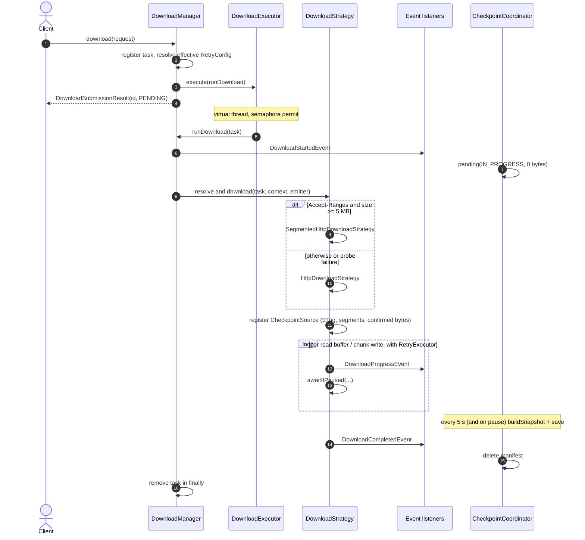
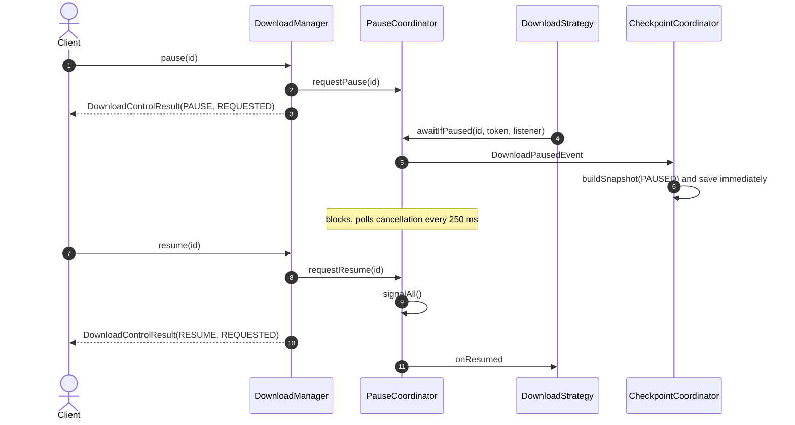
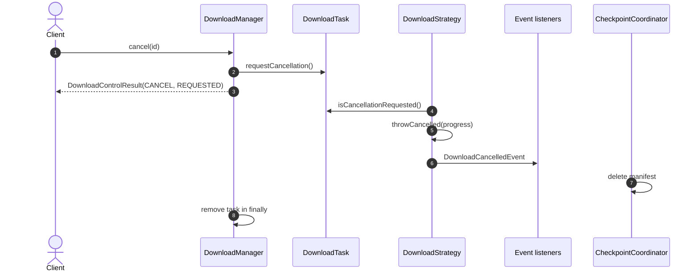

# Download Lifecycle

End-to-end behavior of a download in `katabasis-core`, including retry, checkpoint registration, pause/resume, cancellation, and failure.

**Last verified:** 2026-11-18  
**Baseline:** `f999777`  
**Evidence:** `DownloadManagers`, `HttpDownloadOrchestrator`, `HttpDownloadStrategy`, `SegmentedHttpDownloadStrategy`, `CheckpointCoordinator`, `PauseCoordinator`.

## Happy path

Key points:

- Submission is non-blocking. `download()` returns `PENDING`; work runs on a virtual thread bounded by a semaphore.
- `DefaultDownloadStrategyResolver` accepts only `http`/`https`; other schemes fail with `IllegalArgumentException`.
- The orchestrator probes range support and content length. Segmentation needs both `Accept-Ranges: bytes` and a size ≥ `segmentMinSizeBytes` (5 MB default).
- Each strategy registers a `CheckpointSource` after response/segment negotiation. Snapshots include strong ETag, expected length, confirmed bytes, and segment boundaries.
- Retry is active: `RetryExecutor` wraps read/connection work; `HttpFailureClassifier` decides retryability. A per-request `RetryConfig` overrides the global config.
- Progress is per buffer/chunk. Events are synchronous on the download thread; UI code must marshal to its own thread.
- Terminal completion deletes the checkpoint manifest.

## Pause and resume

- Pause is checkpoint-based: the worker stops at the next buffer/chunk boundary.
- `REQUESTED` means accepted, not already stopped.
- Pause writes a checkpoint synchronously, so the manifest reflects the pause point.
- Segmented downloads guard the callbacks with shared `AtomicBoolean` flags, so exactly one pause and one resume event are emitted per signal (K-0.1-T01).

## Explicit cancellation

- Cancellation is a cooperative flag, not a thread interrupt.
- `DownloadCancelledException` carries bytes read, total bytes, and progress.
- A paused download can still be cancelled; the pause wait polls the token.
- Explicit cancellation deletes the manifest, so the download is not recoverable.

## Failure

Two failure paths both produce `DownloadFailedEvent`:

1. **Inside a strategy** — non-cancellation exceptions go through `HttpDownloadSupport.onError` and are mapped to a `DownloadErrorCode`.
2. **Before execution** — unsupported scheme or invalid request fails in the manager's `runDownload`.

`CheckpointCoordinator` retains a `FAILED` snapshot for inspection instead of deleting it. The task is removed from the registry in `finally`.

## Shutdown is not cancellation

Shutdown-initiated termination suppresses `DownloadCancelledEvent`. The manifest remains `IN_PROGRESS` with post-quiescence progress. Full ordering: [Architecture — Graceful Shutdown](../architecture/katabasis-core.md#graceful-shutdown). CLI behavior: [CLI lifecycle](cli-lifecycle.md).

## Recovery status

Checkpoint discovery exists (`DownloadStateStore.findRecoverable()`), but **resume after restart is not implemented**. K-0.2-T11 is pending. Do not describe the flow above as recovery.

## Related

- [Architecture: current state](../architecture/katabasis-core.md)
- [Checkpointing](../architecture/checkpointing.md)
- [CLI lifecycle](cli-lifecycle.md)
- [Class model](../architecture/class-model.md)
